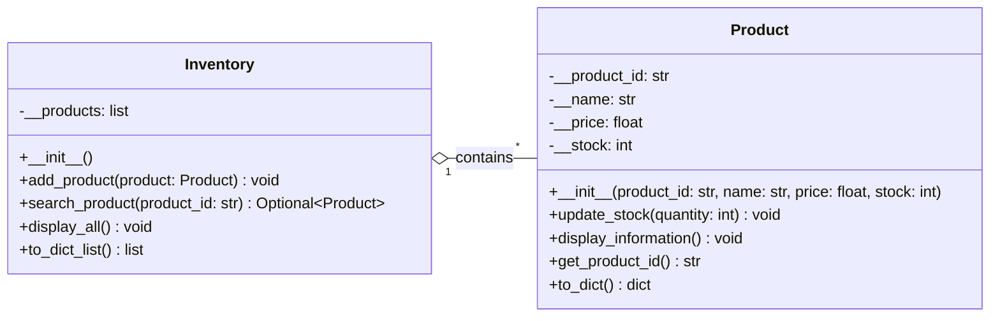

# Lab 6 - UML Class Diagram

### Class Relationship

The `Inventory` and `Product` classes have a **one-to-many aggregation relationship**, where one `Inventory` can contain zero or more (`*`) `Product` objects.

This follows the **Single Responsibility Principle (SRP)**, as `Product` manages individual products while `Inventory` manages the collection.