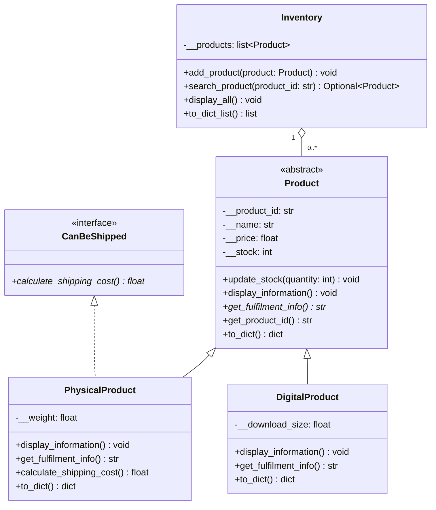

# Lab 7 - UML Class Diagram

### Class Relationship

- **Inheritance:** `PhysicalProduct` and `DigitalProduct` inherit from the abstract `Product` class.
- **Interface Realisation:** `PhysicalProduct` implements `CanBeShipped` to calculate shipping costs.
- **Aggregation:** One `Inventory` contains zero or more `Product` objects.

This design supports **Single Responsibility Principle (SRP)** by separating responsibilities and **Open Close Principle (OCP)** by allowing new product types without modifying the base `Product` class.