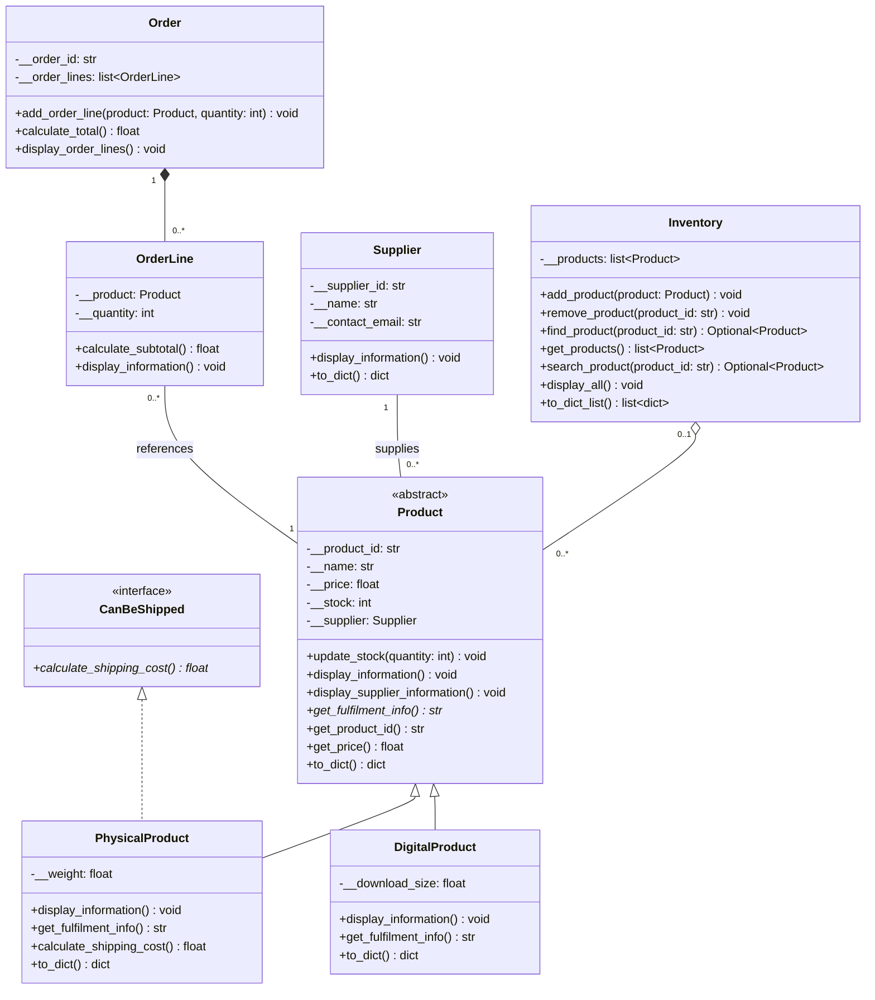

# Lab 8 - UML Class Diagram

### Class Relationships

- **Inheritance:** `PhysicalProduct` and `DigitalProduct` inherit from the abstract `Product` class.
- **Interface Realisation:** `PhysicalProduct` implements `CanBeShipped` to calculate shipping costs.
- **Association:** `Supplier` supplies `Product` objects, while `OrderLine` references a `Product`. Both relationships exist without ownership.
- **Aggregation:** An `Inventory` contains zero or more `Product` objects, which can exist independently of the inventory.
- **Composition:** An `Order` creates and owns its `OrderLine` objects, whose lifecycle is tied to the order.

This design supports the **Single Responsibility Principle (SRP)** by separating responsibilities, the **Open/Closed Principle (OCP)** by allowing new product types without modifying the base `Product` class, and the **Liskov Substitution Principle (LSP)** by allowing subclasses to be used through the common `Product` abstraction.