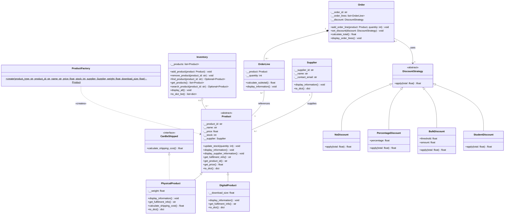

# Lab 9 - UML Class Diagram

### Class Relationships

- **Inheritance:** `PhysicalProduct` and `DigitalProduct` inherit from the abstract `Product` class. `NoDiscount`, `PercentageDiscount`, `BulkDiscount` and `StudentDiscount` inherit from the abstract `DiscountStrategy` class.
- **Interface Realisation:** `PhysicalProduct` implements `CanBeShipped` to calculate shipping costs.
- **Association:** `Supplier` supplies `Product` objects, `OrderLine` references a `Product`, and `Order` uses a `DiscountStrategy`. These relationships exist without exclusive ownership.
- **Aggregation:** An `Inventory` contains zero or more `Product` objects, which can exist independently of the inventory.
- **Composition:** An `Order` creates and owns its `OrderLine` objects, whose lifecycle is tied to the order.
- **Dependency:** `ProductFactory` creates `Product` objects without storing or owning them.

This design supports the **Single Responsibility Principle (SRP)** by separating responsibilities, the **Open/Closed Principle (OCP)** by allowing new discount strategies without modifying `Order`, and the **Liskov Substitution Principle (LSP)** by allowing subclasses to be used through their common abstractions.

Although `ProductFactory` still requires modification when new product types are introduced, it centralises product creation and reduces coupling.

### AI Use Review (Lab 8)

- **Accepted:** I accepted the suggestion to represent the relationship between `Supplier` and `Product` as association because neither object owns the other, and both can exist independently.
- **Changed:** I updated the aggregation multiplicity between `Inventory` and `Product` from `1` to `0..1` at the Inventory end after reviewing the lab sheet, as a Product can exist without belonging to an Inventory.
